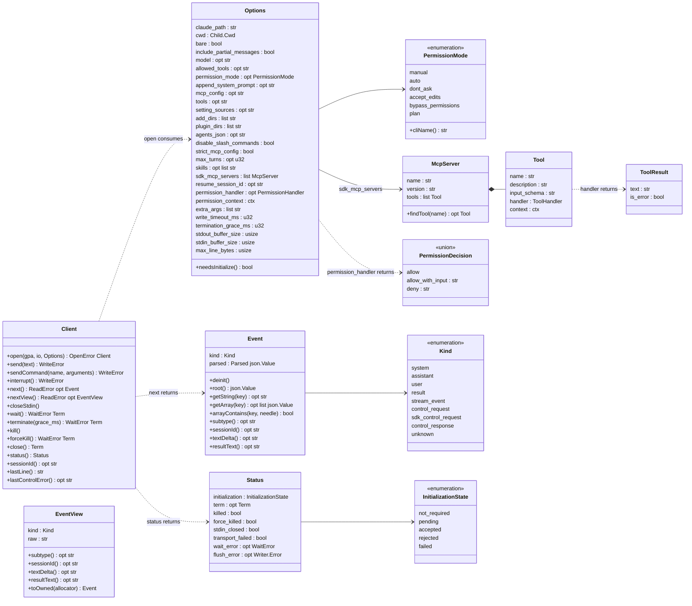

# API reference

Everything a caller uses is re-exported from `src/agent.zig`. Import that
module and nothing else:

```zig
const agent = @import("agent");
```

`zig build docs` generates browsable autodocs from the doc comments into
`zig-out/docs/`. This page groups the same surface by purpose and adds the
contracts that span several declarations.

## Type map

Notation in the diagram: `str` is `[]const u8`, `opt T` is `?T`, `list T` is
`[]const T`, `ctx` is `?*anyopaque`.



## Re-exported names

| Name | Kind | Source |
|---|---|---|
| `Client` | struct | `client.zig` |
| `Options` | struct | `options.zig` |
| `PermissionMode` | enum | `options.zig` |
| `min_cli_version` | `"2.1.228"` | `options.zig` |
| `Event` | struct | `event.zig` |
| `EventView` | borrowed streaming projection | `event.zig` |
| `Kind` | enum | `event.zig` |
| `Tool` | struct | `tool.zig` |
| `ToolHandler` | fn pointer | `tool.zig` |
| `ToolResult` | struct | `tool.zig` |
| `McpServer` | struct | `tool.zig` |
| `PermissionHandler` | fn pointer | `tool.zig` |
| `PermissionDecision` | tagged union | `tool.zig` |
| `OpenError`, `ReadError`, `WriteError` | error sets | `client.zig` |
| `Status`, `InitializationState` | struct, enum | `client.zig` |
| `max_tool_result_bytes` | `16384` | `client.zig` |
| `max_reply_line_bytes` | `16896` | `client.zig` |
| `Term` | `std.process.Child.Term` | std |
| `WaitError` | `std.process.Child.WaitError` | std |

`tests/client_test.zig` pins this surface. Adding a public name means adding
it there.

## Callback signatures

```zig
pub const ToolHandler = *const fn (
    context: ?*anyopaque,
    arena: std.mem.Allocator,
    arguments: std.json.Value,
) anyerror!ToolResult;

pub const PermissionHandler = *const fn (
    context: ?*anyopaque,
    arena: std.mem.Allocator,
    tool_name: []const u8,
    input: std.json.Value,
) anyerror!PermissionDecision;
```

Both run synchronously inside `next()` on the reader's thread. The contract:

- `arena` is the client's scratch arena, reset before each dispatch. Memory
  allocated from it only has to last until the reply is written.
- `arguments` / `input` are JSON `null` when the request carried none.
- A returned error becomes an error result (tools) or a deny (permissions)
  whose text is `@errorName(err)`. `error.OutOfMemory` is answered first and
  then returned from `next()`.
- A handler may call `send`, `sendCommand`, `interrupt`, `kill`,
  `terminate` or `forceKill`. It must not call `next()`, because the read lock
  is not reentrant.

## Options

`Options` is passed by value to `open`. Its slices are borrowed: the data
behind `sdk_mcp_servers`, `skills` and every `Tool` must outlive the client.

### Fields that become CLI flags

`buildArgv` always emits
`<claude_path> --print --input-format stream-json --output-format stream-json --verbose`
and then the flags below, in this order. `extra_args` always comes last.

| Field | Default | Flag emitted |
|---|---|---|
| `claude_path` | `"claude"` | argv[0], resolved through `PATH` |
| `bare` | `false` | `--bare` |
| `include_partial_messages` | `true` | `--include-partial-messages` |
| `model` | `null` | `--model <v>` |
| `allowed_tools` | `null` | `--allowedTools <v>` |
| `permission_mode` | `null` | `--permission-mode <cliName>` |
| `append_system_prompt` | `null` | `--append-system-prompt <v>` |
| `tools` | `null` | `--tools <v>` |
| `setting_sources` | `null` | `--setting-sources <v>` |
| `add_dirs` | `&.{}` | `--add-dir <v>`, once per entry |
| `plugin_dirs` | `&.{}` | `--plugin-dir <v>`, once per entry |
| `agents_json` | `null` | `--agents <v>` |
| `disable_slash_commands` | `false` | `--disable-slash-commands` |
| `strict_mcp_config` | `false` | `--strict-mcp-config` |
| `max_turns` | `null` | `--max-turns <n>` |
| `mcp_config` | `null` | `--mcp-config <v>` |
| `resume_session_id` | `null` | `--resume <v>` |
| `permission_handler` | `null` | `--permission-prompt-tool stdio --permission-prompts host` |
| `extra_args` | `&.{}` | appended verbatim |

`PermissionMode.cliName()` maps `manual`, `auto`, `dont_ask`, `accept_edits`,
`bypass_permissions` and `plan` to `manual`, `auto`, `dontAsk`, `acceptEdits`,
`bypassPermissions` and `plan`.

### Fields carried by the initialize handshake

| Field | Effect |
|---|---|
| `sdk_mcp_servers` | Server names go in `sdkMcpServers`. The client answers their MCP traffic itself. |
| `skills` | `null` omits the field (all skills allowed). `&.{}` sends `[]` (none). A list allows only those names. |
| `permission_handler` | No handshake field, but setting it makes the handshake required. |

`Options.needsInitialize()` is true when any of these three is set.

### Session tuning fields

| Field | Default | Validation in `open` |
|---|---|---|
| `write_timeout_ms` | `5000` | Zero returns `InvalidWriteTimeout`. |
| `termination_grace_ms` | `250` | Used by `kill()`. |
| `stdout_buffer_size` | `64 KiB` | Zero returns `InvalidBufferSize`. |
| `stdin_buffer_size` | `16 KiB` | Zero returns `InvalidBufferSize`. |
| `max_line_bytes` | `32 MiB` | Zero returns `InvalidMaxLineBytes`. The limit is inclusive. |
| `cwd` | `.inherit` | Passed to `std.process.spawn`. |
| `permission_context` | `null` | Passed untouched to `permission_handler`. |

## Error sets

### `OpenError`

| Error | Cause |
|---|---|
| `InvalidMaxLineBytes` | `max_line_bytes == 0` |
| `InvalidWriteTimeout` | `write_timeout_ms == 0` |
| `InvalidBufferSize` | A stdin or stdout buffer size of zero. |
| `InvalidRegistration` | Empty or duplicate server name, or empty or duplicate tool name within a server. |
| `InvalidToolSchema` | An `input_schema` that is not a JSON object, or nests deeper than 128. Checked before spawning. |
| `TransportFailed` | `fcntl` could not make a pipe nonblocking. |
| `WriteTimedOut` | The initialize write did not finish within `write_timeout_ms`. |
| `std.process.SpawnError` | The CLI could not be spawned. |
| `Allocator.Error`, `Io.Writer.Error` | Allocation or write failure. |

### `WriteError` (from `send`, `sendCommand`, `interrupt`)

| Error | Meaning | Recoverable |
|---|---|---|
| `StdinClosed` | `closeStdin` already ran. | No, for this session's writes. |
| `WriteFailed` | Pipe write failed or wrote zero bytes. The transport is now terminal. | No |
| `WriteTimedOut` | `write_timeout_ms` passed mid-frame. The transport is now terminal. | No |
| `TransportFailed` | The transport had already stopped or failed. | No |
| `TooManyPendingRequests` | All 16 correlation slots are in use (`interrupt` only). | Yes, after responses arrive. |
| `ReplyTooLong` | Internal reply exceeded the frame budget. | No |

### `ReadError` (from `next`)

| Error | Meaning | Caller action |
|---|---|---|
| `InvalidJson` | One line did not parse. | Log `lastLine()` and call `next()` again. |
| `ProtocolTooLong` | One line exceeded `max_line_bytes`. The rest of it was discarded. | Log `lastLine()` and call `next()` again. |
| `ControlRequestRejected` | The CLI rejected an interrupt. Text is in `lastControlError()`. | Keep reading. |
| `InitializationRejected` | The CLI rejected the handshake. SDK tools and skill limits are not active. | Stop if they are required. Text is in `lastControlError()`. |
| `ProtocolTooDeep` | JSON nesting above 128. The child has been force-killed. | Terminal. |
| `ReplyTooLong` | A correlated fallback reply could not fit. The child has been force-killed. | Terminal. |
| `StdinClosed` | A control request arrived after `closeStdin`. | Terminal for tool service. |
| `WriteFailed`, `WriteTimedOut`, `TransportFailed`, `ReadFailed` | Pipe failure. | Terminal. Call `terminate`. |
| `OutOfMemory` | Host allocation failure. | Host decision. |

## Limits

| Limit | Value | What happens on overflow |
|---|---|---|
| Tool result text | 16 384 bytes | The call is answered with an `isError` result explaining the cap. |
| Complete control reply frame | 16 896 bytes, newline included | `initialize` and `tools/list` get a JSON-RPC `-32603` error, permission replies become short denials. If even the fallback cannot fit with its correlation ids, `next()` returns terminal `ReplyTooLong`. |
| Inbound line | `max_line_bytes` (32 MiB) | `ProtocolTooLong`; that line is skipped. |
| JSON nesting | 128 containers | Inbound: terminal `ProtocolTooDeep`. Schemas: `InvalidToolSchema`. Replacement input: deny. |
| Pending control requests | 16 | `TooManyPendingRequests`. |
| Retained buffer capacity | 1 MiB | Larger line buffers and scratch arenas are released on next use. |

## Event accessors

`nextView()` shares the `ReadError` set and control handling of `next()`. Its
`EventView` offers the four named accessors below, plus `kind` and `raw`. It
validates the full line and duplicate keys while skipping unneeded values.
All view data expires at the next call to either read API or at `close()`;
no view `deinit` is needed. `try view.toOwned(allocator)` retains an independent
full event, including unknown fields, and can fail with JSON parse errors or
`OutOfMemory`. Release that copy with `deinit()`.

| Accessor | Returns |
|---|---|
| `root()` | The whole parsed line. |
| `getString(key)` | A top-level string field, or `null`. |
| `getArray(key)` | A top-level array field, or `null`. |
| `arrayContains(key, needle)` | Whether a top-level string array contains `needle`. |
| `subtype()` | `getString("subtype")`. |
| `sessionId()` | `getString("session_id")`. |
| `textDelta()` | For `stream_event`, `event.delta.text` when `event.delta.type == "text_delta"`. |
| `resultText()` | For `result`, `getString("result")`. |

Every returned slice points into the event's parse tree and is valid until
`deinit()`.
