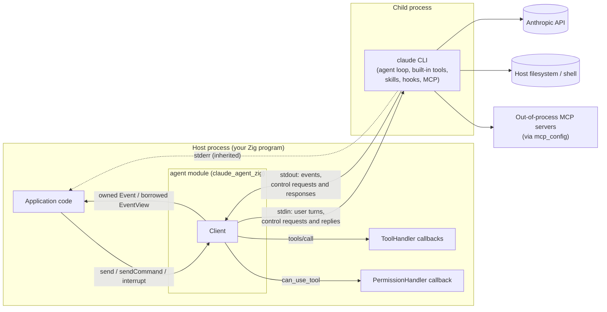
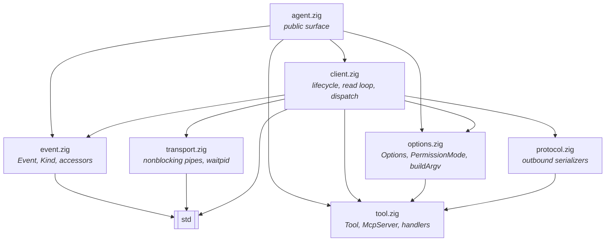
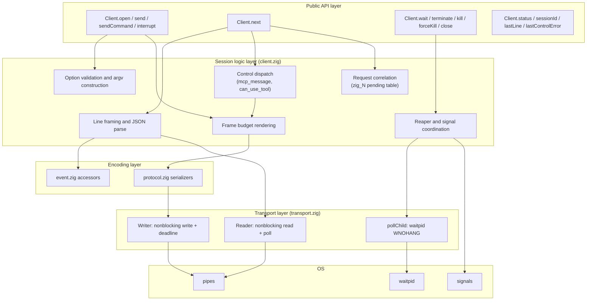
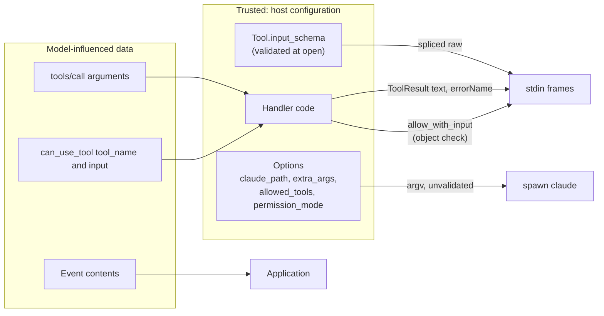

# Architecture

## Design premise

Anthropic publishes the Agent SDK for Python and TypeScript only. Both are
wrappers around one CLI invocation:

```
claude --print --input-format stream-json --output-format stream-json --verbose
```

This library implements the same protocol in Zig. It does not reimplement the
agent loop. Tool use, subagents, hooks, skills, MCP and session persistence
all stay inside the CLI. The library's job is to:

1. Turn `Options` into a CLI argv and spawn the child.
2. Write user turns and control messages to the child's stdin, one JSON
   object per line.
3. Read events from the child's stdout, one JSON object per line, and hand
   them to the caller.
4. Answer the CLI's control requests (in-process MCP tool calls and
   permission prompts) by calling host callbacks.
5. Own the child's lifetime: reap it, signal it, and release every resource.

## System context



The library does no network I/O. Authentication, billing and model access
belong to the CLI.

## Module graph

Callers import one module, `agent` (`src/agent.zig`). It re-exports the
public names from the other files. Edges point from importer to imported
file.



`client.zig` is the only module that pulls in all the others. `tool.zig` is a
leaf: it holds plain data types and two lookups, `findServer` and
`McpServer.findTool`.

### Public versus internal

Several declarations are `pub` so that sibling files can call them, but
`agent.zig` deliberately does not re-export them. They are internal.

| Internal `pub` declaration | Used by |
|---|---|
| `options.buildArgv` | `Client.open` |
| `tool.findServer` | `Client.serveControlRequest` |
| Everything in `protocol.zig` | `Client` write paths |
| `transport.Reader`, `transport.Writer`, `transport.State`, `transport.pollChild` | `Client` |
| `event.objectField`, `event.stringField` | `Client`, `Event` accessors |

## Layered view



## Key design decisions

| Decision | Reason |
|---|---|
| `Client` lives on the heap (`open` returns `*Client`). | `transport.Reader` and `transport.Writer` embed `Io.Reader` / `Io.Writer` interfaces that recover their parent with `@fieldParentPtr`, so the address must not move. |
| Owned events use `std.json.Value`; borrowed views project selected fields while validating the full line. | Both tolerate unknown fields. Views retain the raw line and can become a full owned event when arbitrary fields are needed. |
| `Kind` is exhaustive, with an `unknown` member. | Every unrecognized wire `type` maps to `unknown`, so a non-exhaustive `_` tag would never occur. Callers should write an `else` arm. |
| Control requests are handled inside `next()`. | The CLI sends tool calls over the same pipe and waits for the reply. Answering them on the reader's thread needs no extra thread or socket. |
| Raw JSON is validated before it is spliced. | `Tool.input_schema` and `PermissionDecision.allow_with_input` are written verbatim. `open` and the permission path validate them so a bad value cannot break framing. |
| Every control reply is rendered into a fixed buffer first. | This enforces the 16 896-byte complete-frame budget before any byte reaches the pipe, so a reply is never written halfway. |
| Write deadline with a terminal failure. | After a partial or timed-out write the stream position is unknown, so later writes are refused instead of continuing a broken frame. |
| Exact Zig toolchain pin. | `minimum_zig_version` is only a floor. `build.zig` rejects any other version so an untested toolchain fails at the first line instead of somewhere inside `std`. |
| No dependencies. | The compiler and `std` are the whole supply chain. |

## Trust boundaries



- `claude_path` and `extra_args` are not validated. Treat them as command
  execution and never build them from user input.
- Tool arguments and permission inputs come from the model. Handlers must
  validate them.
- Error names returned by handlers are sent back as text the model reads.
- `bare = true` is not a sandbox. The tool boundary is `tools`,
  `allowed_tools` and `permission_mode`.

See [SECURITY.md](../SECURITY.md) for the full attack-surface analysis.

## Platform scope

macOS on Apple Silicon is the validated target. The transport uses POSIX
`fcntl`, `poll`, `read`, `write`, `kill` and `waitpid`. Linux is untested.
Windows is unsupported. Integration tests and the benchmark also need
`/bin/sh`.
