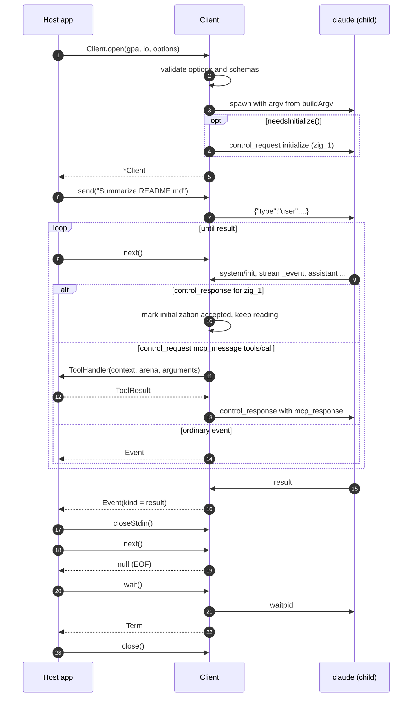
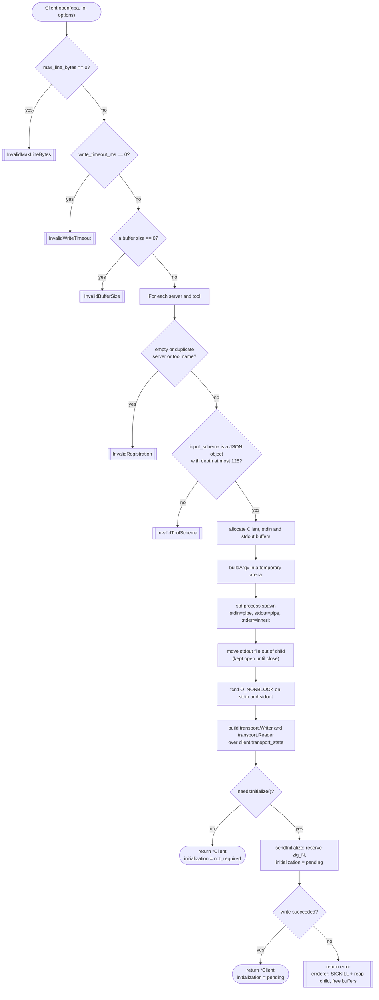
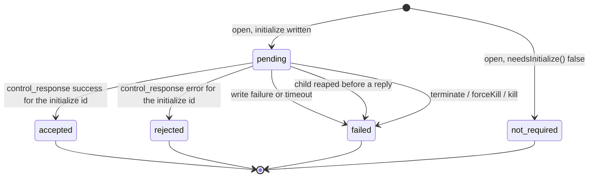
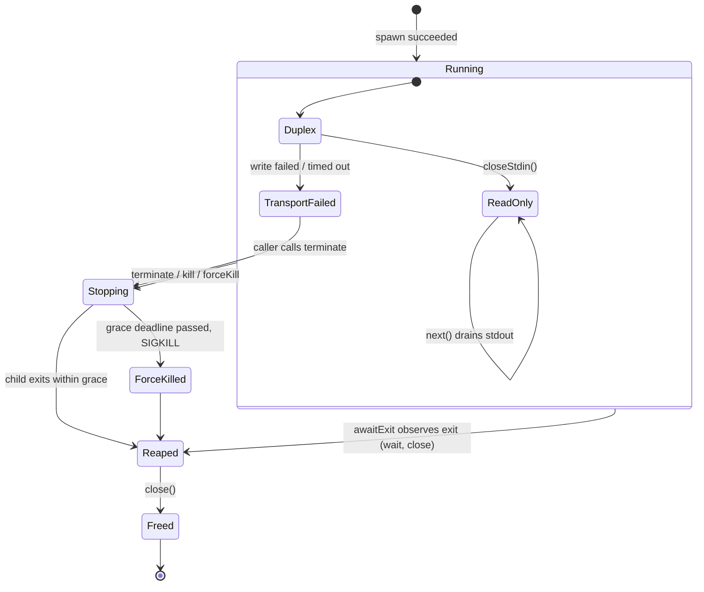
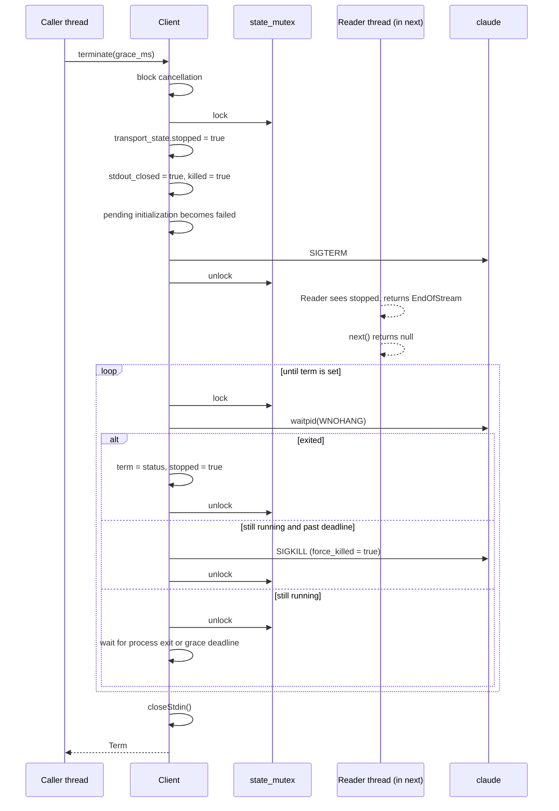
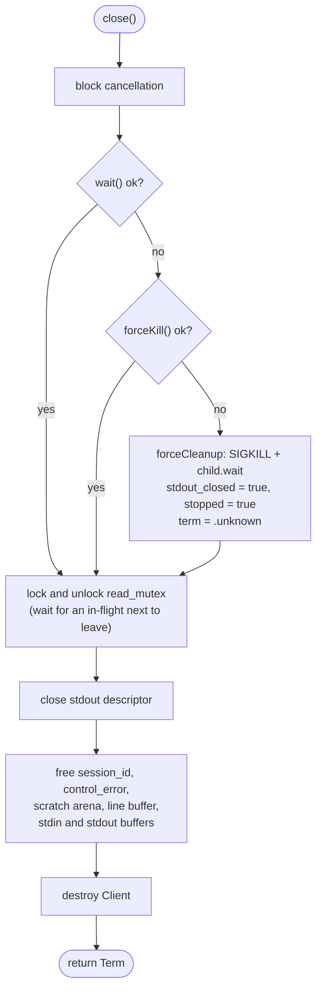

# Client lifecycle

This page follows a `Client` from `open` to `close`: validation, spawning,
the initialize handshake, a turn, and the shutdown paths.

## End-to-end session

A typical single foreground turn with one in-process tool call:

## `open`

`Client.open` checks everything it can before it spawns, so that a bad
configuration fails with an error the caller can see rather than as a broken
frame halfway through a session.

Notes:

- The argv arena is freed as soon as `spawn` returns. The child does not keep
  a reference to it.
- The stdout file is taken out of `child.stdout` so that reaping the child
  never closes a descriptor an active reader is still using. Only `close`
  releases it.
- `open` sends the handshake but does not wait for the reply. The reply is
  processed by the first `next()` calls.
- Every failure after the spawn runs `forceCleanup`, which sends SIGKILL and
  reaps the child, so no zombie or orphan is left behind.

## Initialization state machine

`Status.initialization` reports the handshake's progress.

On `rejected`, `next()` returns `error.InitializationRejected` once and
`lastControlError()` holds the CLI's text. SDK tools and skill restrictions
are not active in that session. Reading may continue, but stop the session if
those features are required.

## Process and transport state

The client tracks the child and pipes with several flags. This diagram shows
how they combine as the session moves toward its end.

| Flag | Set by | Effect |
|---|---|---|
| `stdin_closed` / `transport_state.stdin_closed` | `closeStdin` (also run by `wait`, `terminate`, `forceKill`) | Later writes return `StdinClosed`. |
| `transport_state.failed` | Any failed or timed-out write; `ProtocolTooDeep`; `ReplyTooLong` | Reader returns `ReadFailed` / `TransportFailed`; writers refuse. |
| `transport_state.stopped` | `requestSignal`, reaping | Reader returns end of stream; writers refuse. |
| `stdout_closed` | `requestSignal`, reaping | `next()` returns `null`. |
| `killed`, `force_killed` | `requestSignal`, grace escalation | Reported in `status()`. |
| `term` | `awaitExit` after `waitpid` reports the exit | Reaping is done; the PID is never signaled again. |

## Shutdown paths

| Call | Closes stdin | Signal | Waits | Grace | Returns |
|---|---|---|---|---|---|
| `wait()` | Yes, first | None | Until exit, no deadline | n/a | `WaitError!Term` |
| `terminate(grace_ms)` | Yes, after the reap | SIGTERM, then SIGKILL after `grace_ms` | Until exit | `grace_ms` | `WaitError!Term` |
| `kill()` | Yes | Same as `terminate(termination_grace_ms)` | Until exit | `Options.termination_grace_ms` | nothing; errors discarded |
| `forceKill()` | Yes | SIGKILL | Until exit | none | `WaitError!Term` |
| `close()` | Yes | Only if `wait` fails (then `forceKill`) | Until exit | none | `Term` (`.unknown` if reaping failed) |

### `terminate` sequence

Setting `stopped` before sending the signal matters. A reader or writer
blocked on a pipe that a descendant process still holds open would otherwise
wait forever. Publishing the flag also signals the wake descriptor, releasing
both I/O waits. On macOS the exit descriptor avoids periodic process polling;
other platforms and runtimes without concurrent capacity retain a fallback.

### `close`

`close` must be the last call on the client. Join every thread that uses the
client first: after `close` the memory is gone.

## Multi-turn and background work

- **Multi-turn**: do not call `closeStdin`. Read until `result`, then `send`
  again on the same client.
- **Mid-turn guidance**: `send` while a turn is running is valid. The CLI
  treats it as guidance.
- **Background tasks**: these can issue SDK tool calls after the foreground
  `result`. Keep reading, and only call `closeStdin` once that work is done.
  A tool call that arrives after `closeStdin` makes `next()` return
  `StdinClosed`.
- **Resume**: read `sessionId()` (captured from the first event that carries
  `session_id`) and pass it as `resume_session_id` to a later `open`.

## Interrupts

`interrupt()` reserves a `zig_N` id and writes an `interrupt` control request.
The CLI's answer arrives on stdout as a `control_response`:

- `success`: the slot is released and nothing reaches the caller. The current
  turn is cancelled. The CLI may then send a `result` with
  `error_during_execution` and exit with status 1. Check
  `event.getString("terminal_reason")` for `aborted_streaming` or
  `aborted_tools`.
- `error`: `next()` returns `ControlRequestRejected` and the text goes in
  `lastControlError()`. Reading may continue.
