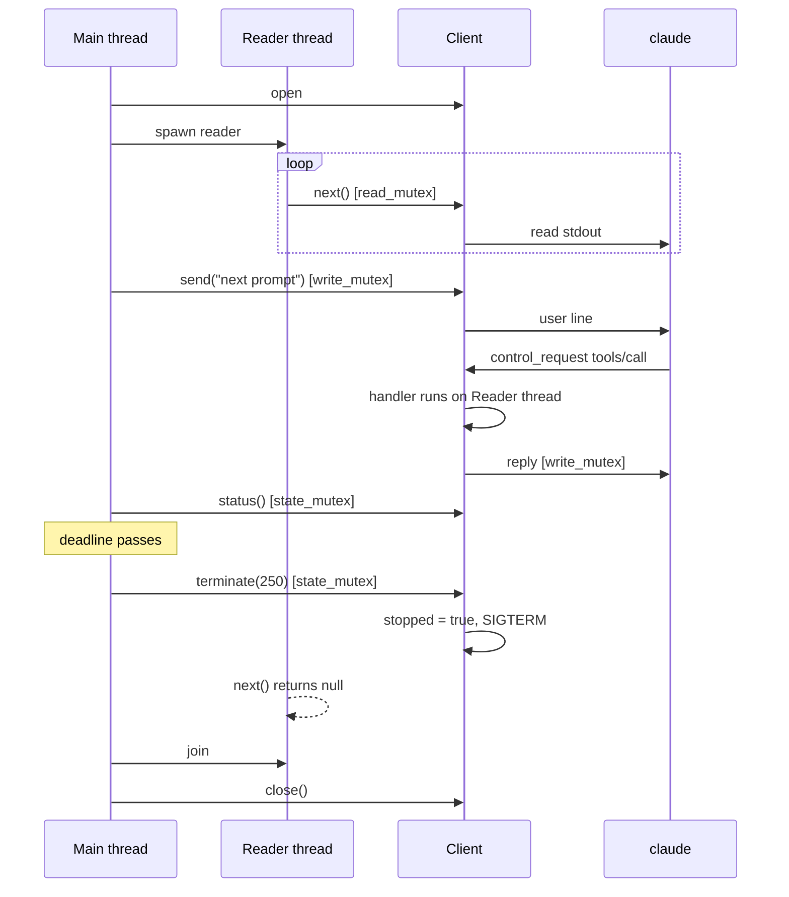

# Concurrency model

The client can be used from several threads at once, within the rules below.
Synchronization uses three `Io.Mutex` locks and three atomic flags. Each lock
protects a separate resource.

## Locks

| Lock | Protects | Taken by |
|---|---|---|
| `read_mutex` | The stdout reader, line buffer, scratch arena, `control_error`, handler execution | `next()`; `close()` takes and releases it to wait for an in-flight `next()` |
| `write_mutex` | The stdin writer and buffer, `stdin_closed`, the pending-request table, the request counter | `send`, `sendCommand`, `interrupt`, `closeStdin`, every reply write, `noteControlResponse` |
| `state_mutex` | `term`, `killed`, `force_killed`, `wait_error`, `flush_error`, `initialization`, `session_id`, `stdout_closed`, every signal and `waitpid` | `status`, `sessionId`, `requestSignal`, `awaitExit`, plus short updates from the other paths |

All three are taken with `lockUncancelable`, so cancelling a task never
leaves one held.

## Lock order

A thread holding a lock may only take locks to its right:

- `next()` holds `read_mutex` and takes `write_mutex` to write a reply or
  update the pending table.
- Write paths hold `write_mutex` and take `state_mutex` to record
  `flush_error` or a failed initialization.
- `state_mutex` never waits for either I/O lock, so a status snapshot or a
  signal never blocks behind a stuck read or write.

`write_mutex` is not held while a handler runs. The reply is written after
the handler returns, so a handler may call `send`.

## Atomic transport flags

`transport.State` holds three `std.atomic.Value(bool)` flags, read with
`.acquire` and written with `.release`. The `transport.Reader` and
`transport.Writer` read them in their poll loops without taking a lock.

| Flag | Set when | Reader reaction | Writer reaction |
|---|---|---|---|
| `stopped` | Termination is requested, or the child is reaped | Returns `EndOfStream` | Returns `WriteFailed` |
| `failed` | A write fails or times out; `ProtocolTooDeep`; `ReplyTooLong` | Returns `ReadFailed` (`next` reports `TransportFailed`) | Returns `WriteFailed` |
| `stdin_closed` | `closeStdin` | (not read) | Shown in `status()` |

Because the reader and writer check these flags every 2 ms poll, setting
`stopped` releases a thread blocked on a pipe without touching its
descriptor. This matters when a grandchild inherited the pipe and keeps it
open after the direct child exits.

## Thread safety by method

| Method | Safe from other threads while `next()` runs | Notes |
|---|---|---|
| `send`, `sendCommand` | Yes | Serialized with replies, one whole line at a time. |
| `interrupt` | Yes | Uses a pending-table slot. |
| `closeStdin` | Yes | Idempotent. A reply afterwards gets `StdinClosed`. |
| `status`, `sessionId` | Yes | Synchronized snapshot. |
| `wait`, `terminate`, `kill`, `forceKill` | Yes | Share one reaper. `kill` is idempotent. |
| `next` | No: one consumer at a time | Calls are serialized. Handlers must not reenter it. |
| `lastLine`, `lastControlError` | No: reader thread only | Borrowed until the next `next()` or rejection. |
| `close` | No: must be the last call | Join every other thread first. |

Direct reads of public fields such as `client.term` are not synchronized.
Use `status()` while other threads are running.

## Typical threaded host

## The single reaper

`wait`, `terminate`, `kill`, `forceKill` and `close` all go through
`awaitExit`. It polls `waitpid(WNOHANG)` every 2 ms under `state_mutex`. The
signal path takes the same lock, which prevents two problems:

- **PID reuse**: once `waitpid` reports an exit, `child.id` is set to `null`
  and `term` is stored under the lock. Later signal requests see `term` and do
  nothing, so a recycled PID is never signaled.
- **Double reaping**: if another reaper already collected the child
  (`ECHILD`), `pollChild` clears `child.id` and returns `error.Unexpected`
  rather than retrying forever.

### Host obligations

- Do not reap the SDK's child yourself, and do not enable automatic `SIGCHLD`
  reaping.
- Keep `SIGPIPE` ignored. The default `std.Io.Threaded` setup does this, so
  writing to a closed pipe returns an error instead of killing the process.
- Handlers run synchronously on the reader thread. A handler that never
  returns defeats any join or `close()` deadline. Use cooperative
  cancellation or process isolation if you need hard limits on callbacks.

## Cancellation

`terminate`, `forceKill`, `close` and `forceCleanup` switch to
`swapCancelProtection(.blocked)` for their duration, so a cancellation
request cannot interrupt cleanup halfway. Cancelling a thread that is waiting
on the child does not give up ownership of that child. The transport's
read and write loops call `io.checkCancel()` and turn a cancellation into
`ReadFailed` / `WriteFailed`.
