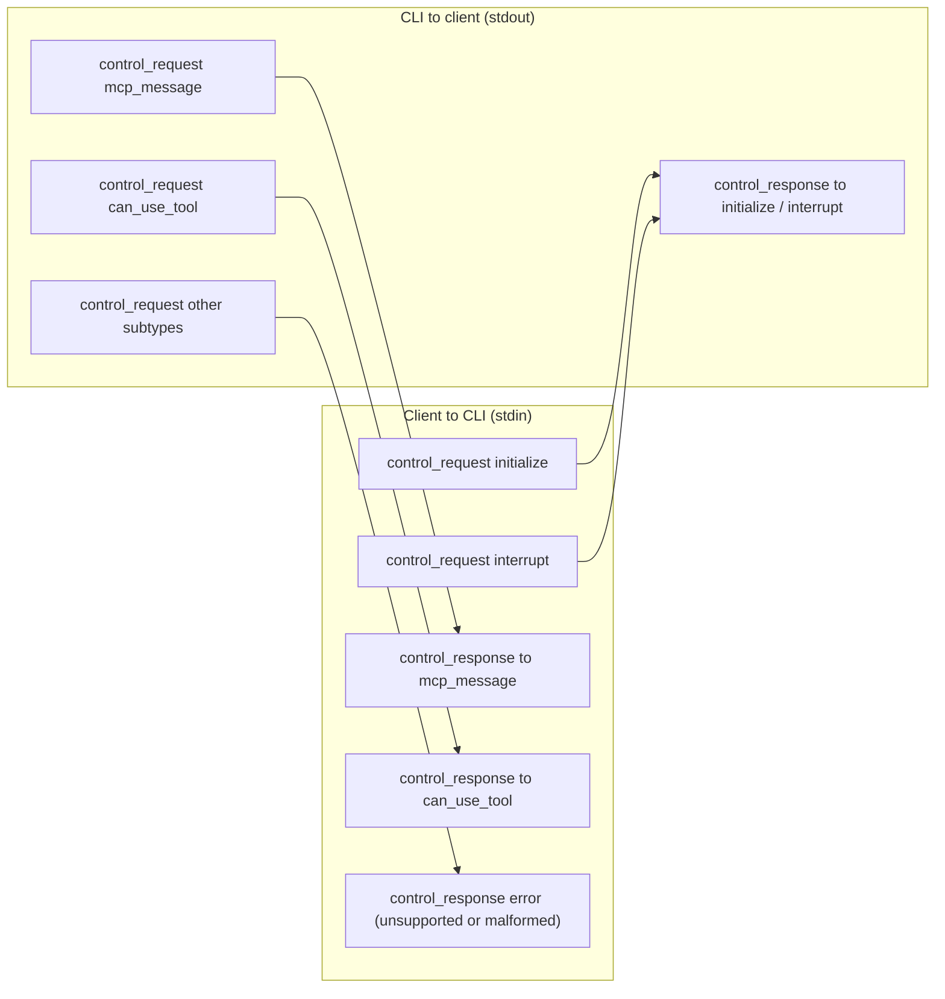
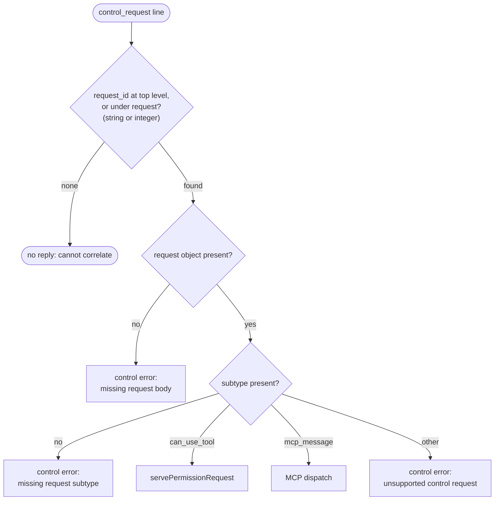
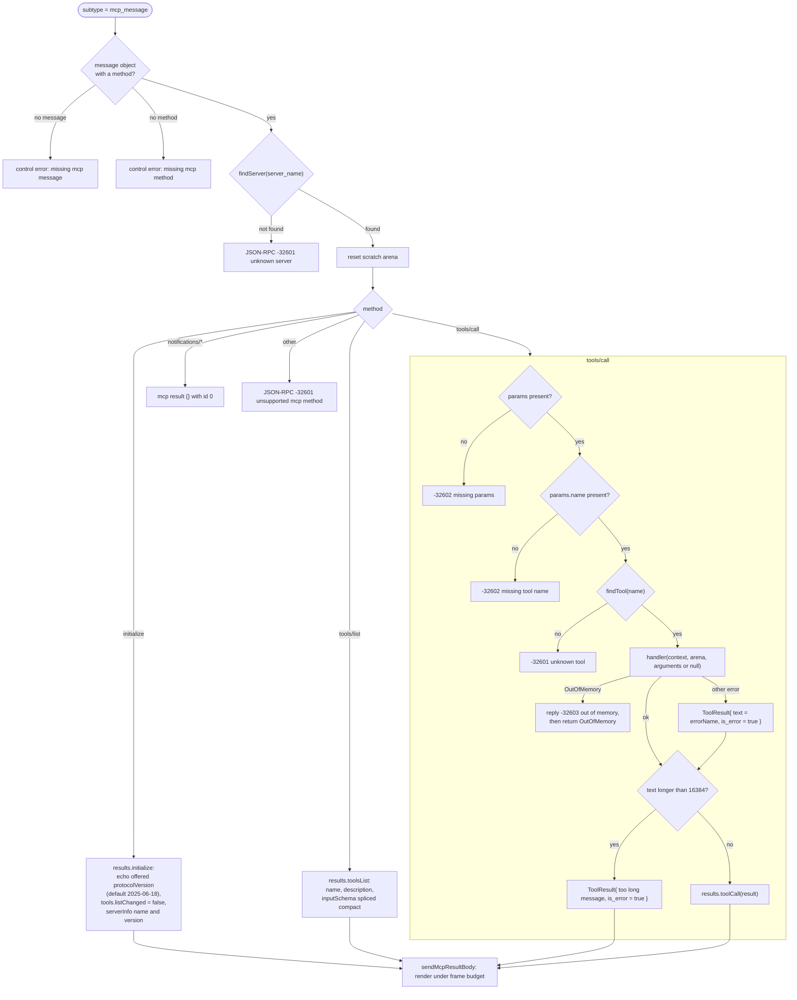
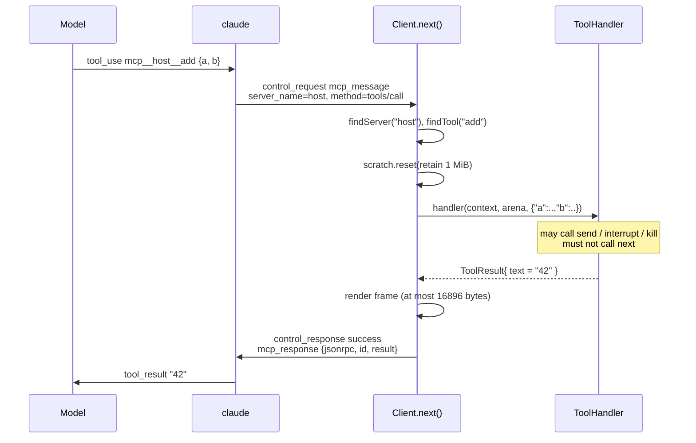
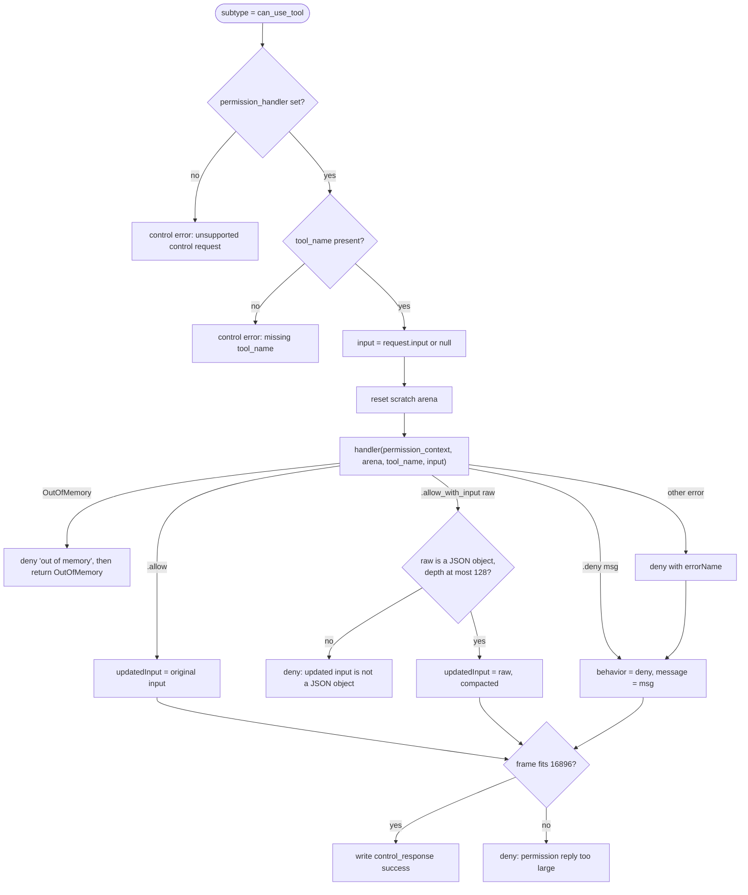
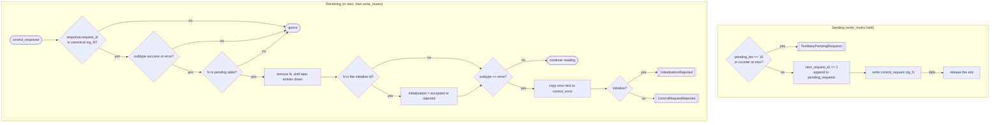
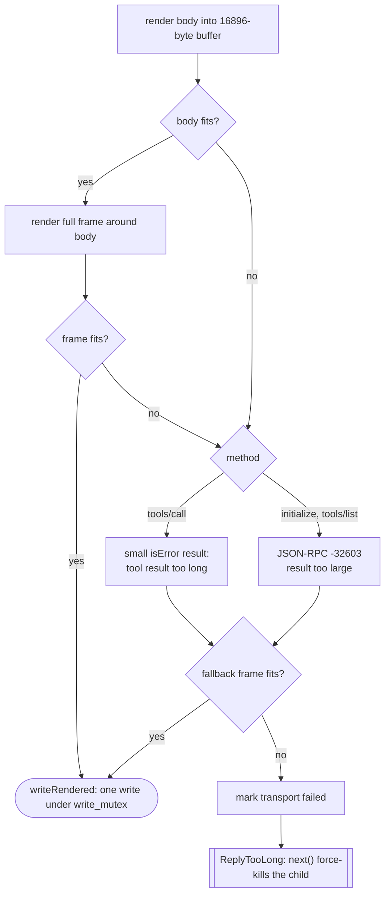

# Control protocol

Besides user turns and events, the stdin and stdout pipes carry a control
channel. Both sides send `control_request` lines and answer with
`control_response` lines. This page covers how the client:

- answers the CLI's requests (in-process MCP traffic and permission prompts),
- sends its own requests (`initialize`, `interrupt`) and matches the answers,
- keeps every reply inside the frame budget.

Exact JSON shapes are in [wire-protocol.md](wire-protocol.md).

## Directions

## Inbound request dispatch

`serveControlRequest` runs inside `next()` with `read_mutex` held. Every
request that has a usable id gets exactly one reply, including malformed
ones, so the CLI never waits for an answer that is not coming. A request with
no id cannot be matched to a reply, and is the only case left unanswered.

Integer ids are converted to decimal text (up to 20 characters, so
`-9223372036854775808` fits) and echoed back as strings.

## MCP dispatch

In-process tools are exposed to the CLI as SDK MCP servers. The CLI wraps
each JSON-RPC message in a `mcp_message` control request naming the server.

Tools appear to the model as `mcp__<server>__<tool>`, so the allow rule for a
whole server is `mcp__<server>__*`.

### Why `mcp_response` matters

Every MCP reply is wrapped as
`control_response.response.response.mcp_response`. The CLI uses that wrapper
to match the JSON-RPC reply to its request. It is not documented, and without
it the CLI never sees the reply and waits until its own timeout.

### Tool call sequence

## Permission prompts

When `Options.permission_handler` is set, the client passes
`--permission-prompt-tool stdio --permission-prompts host`. The first flag is
what makes the CLI send each prompt over this pipe. The second, on its own,
blocks the call without sending any request (measured against CLI 2.1.261).
`allowed_tools` and `permission_mode` are applied first. Only calls they do
not decide reach the handler.

All three decisions go out as `subtype: "success"` control responses. The
outcome is carried in `behavior`. The CLI needs `updatedInput` even when the
input did not change, which is why `.allow` echoes it.

## Outbound requests and correlation

The client numbers its own requests `zig_1`, `zig_2`, ... and keeps up to 16
outstanding numbers in a fixed array, oldest first. `initialize` and
`interrupt` share the slots.

`ownRequestNumber` accepts only the canonical spelling: the `zig_` prefix
followed by decimal digits with no leading zero. Responses to ids the client
did not issue are ignored.

## Frame budget

Every reply to the CLI is rendered into a fixed stack buffer of
`max_reply_line_bytes` (16 896 bytes) before it is written. That size covers
escaped content, ids, the envelope and the newline. Rendering first means the
client never starts writing a frame it cannot finish.

The fallback can only fail to fit when the correlation ids alone are close to
the budget. Ids are never truncated, because a truncated id cannot be
matched and the CLI would wait forever.

Outbound requests (`initialize`, `interrupt`) are not rendered first. They are
written straight to the stdin writer under the write deadline.
