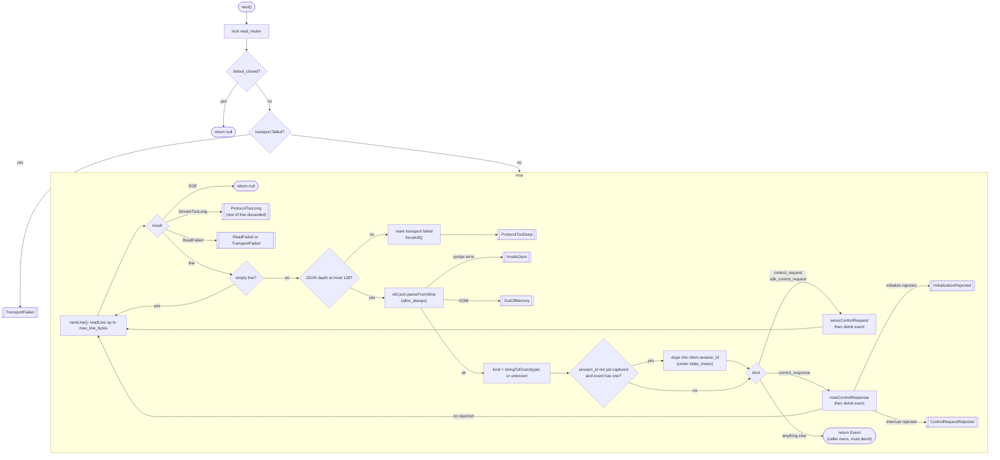
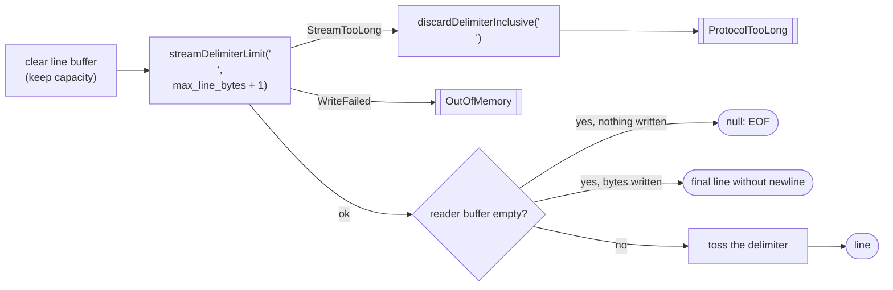
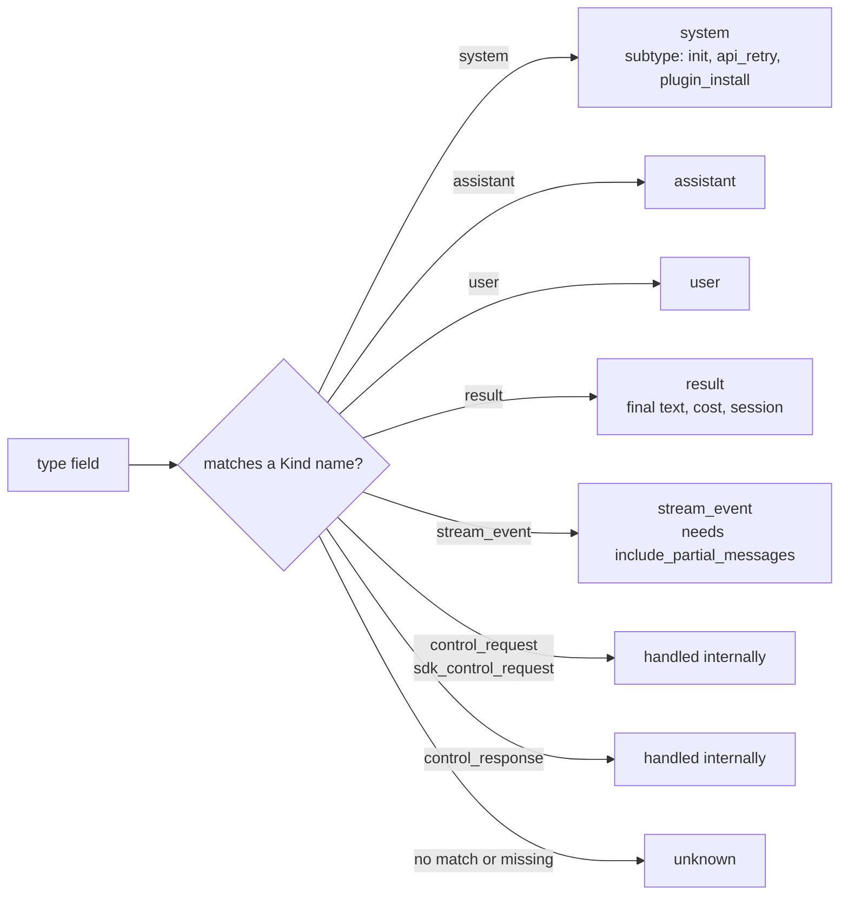
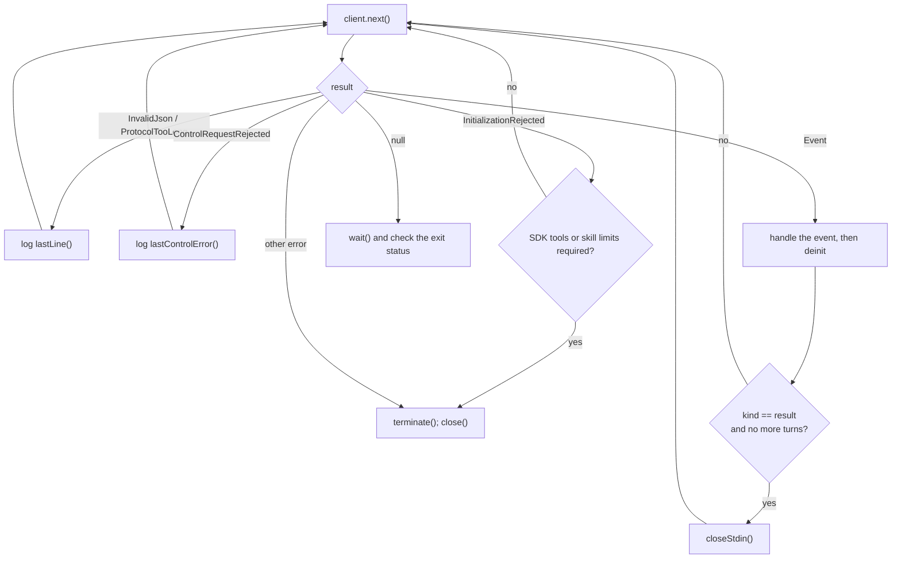

# The read loop: `Client.next()`

`next()` is the only way to receive events. It also drives the control
channel: tool calls, permission prompts and control responses are handled
inside it and never reach the caller. A host that wants tool calls served
while it does other work keeps one thread inside `next()`.

## Control flow

Errors from `serveControlRequest` map as follows:

| Dispatch error | `next()` returns | Side effect |
|---|---|---|
| `OutOfMemory` | `OutOfMemory` | The CLI was answered first. |
| `StdinClosed` | `StdinClosed` | none |
| `WriteTimedOut` | `WriteTimedOut` | Transport is terminal. |
| `ReplyTooLong` | `ReplyTooLong` | `forceKill()` |
| `TransportFailed` | `TransportFailed` | none |
| anything else | `WriteFailed` | Transport is terminal. |

## Line framing

The protocol is one JSON object per `\n`-terminated line. `readLine` streams
bytes into a growable `Io.Writer.Allocating` with `streamDelimiterLimit`, so
a single line larger than the stdout buffer still works.

Behavior pinned by tests in `src/client.zig`:

- A line of exactly `max_line_bytes` is accepted. One byte more is rejected.
- An oversized line costs that one line, not the stream. The next line reads
  normally.
- An oversized line at end of stream still ends cleanly.
- A final line without a trailing newline is still returned.
- `max_line_bytes = maxInt(usize)` does not wrap to a zero budget (the `+ 1`
  saturates).
- EOF is detected by an empty reader buffer, because `streamDelimiterLimit`
  leaves the delimiter buffered on success.

## Event classification

The wire `type` field picks the `Kind`:

Only `system`, `assistant`, `user`, `result`, `stream_event` and `unknown`
reach the caller. Because `unknown` absorbs every new wire type, write
`else` in any `switch (e.kind)`. A named `Kind` added later would otherwise
break exhaustive switches.

## Ownership and lifetimes

| Value | Owner | Valid until |
|---|---|---|
| `Event` returned by `next()` | Caller | `event.deinit()` |
| Slices from `Event` accessors | The event's parse tree | `event.deinit()` |
| `lastLine()` | Client, reader thread only | The next `next()` call |
| `lastControlError()` | Client, reader thread only | The next rejection or `close()` |
| `sessionId()` | Client, synchronized | `close()` |

`lastLine()` always holds the raw bytes of the most recent line, whatever
happened to it: the line behind the returned event, the line that failed to
parse, or the prefix kept before `ProtocolTooLong`. It is empty before the
first read and after EOF.

## Memory retention

Most lines are small, so the line buffer and the scratch arena behind tool
dispatch keep their capacity between uses and the common case allocates
nothing. To stop one large event from pinning memory for the rest of the
session, both are released once they grow past 1 MiB:

- The line buffer is reinitialized at the start of the next `nextLine` if its
  capacity is above 1 MiB. Doing it then, not right away, keeps `lastLine()`
  valid until the next read.
- The scratch arena is reset with `retain_with_limit = 1 MiB` before each
  dispatch.

The benchmark's `recovery` workload (one 2 MiB event, then small deltas)
checks this.

## Recommended caller loop

A CLI that fails at startup produces no events. The loop ends with `null`,
and only the exit status from `wait()` shows the failure. Always check it.
