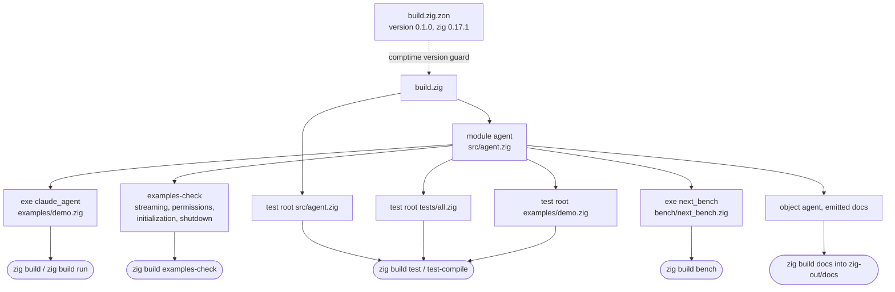
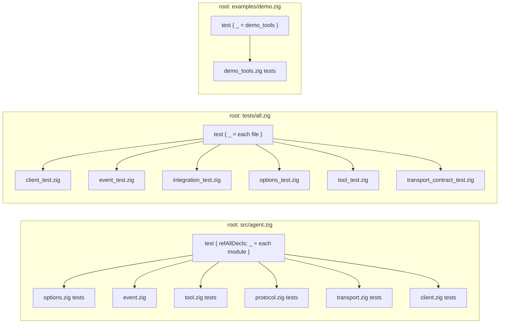
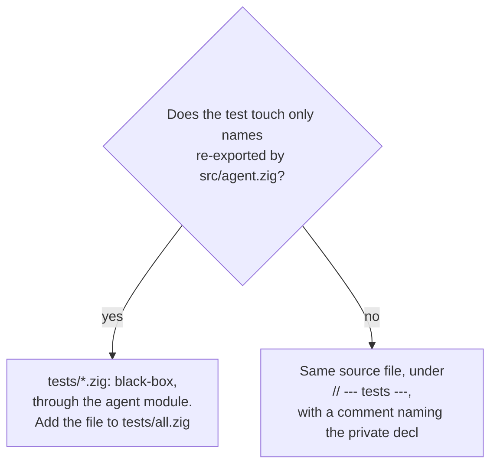
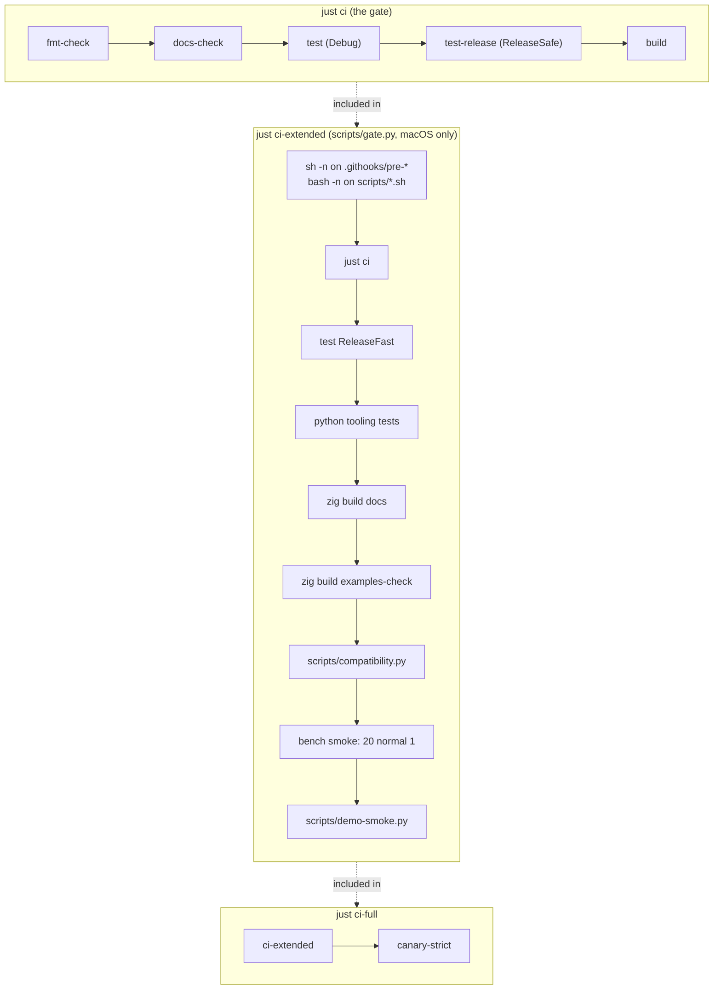
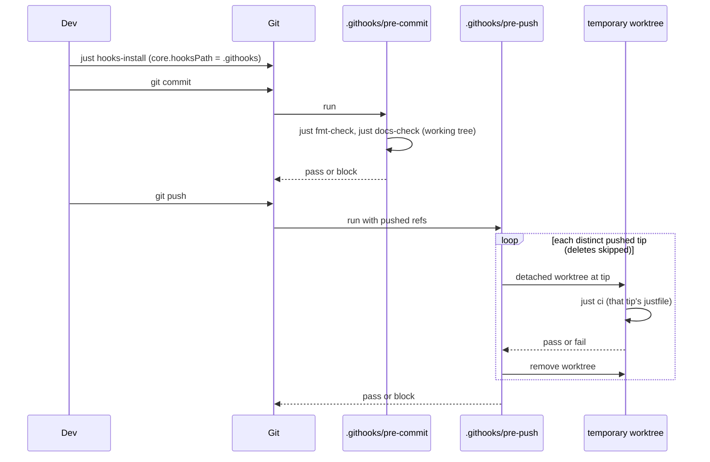
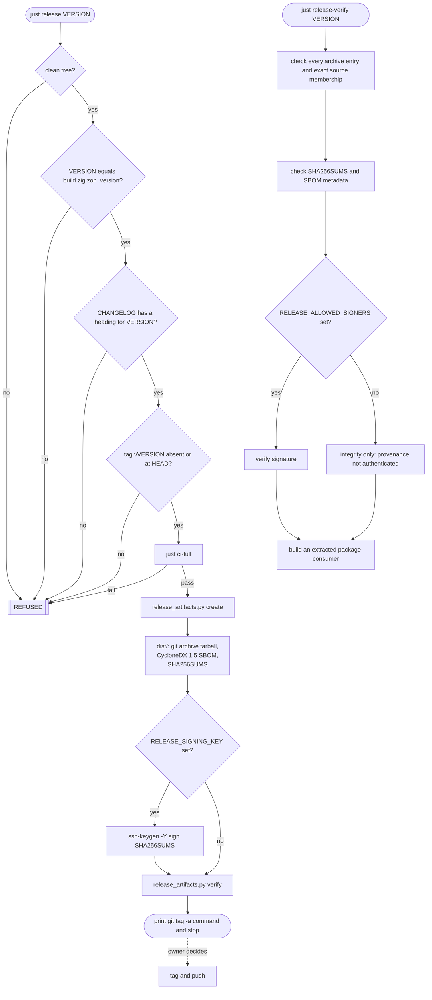

# Build, test and delivery tooling

All CI is local by design: there is no hosted workflow. The gate is a set of
`just` recipes, enforced by version-controlled git hooks in `.githooks/`.

## Toolchain

| Requirement | Version | Enforced by |
|---|---|---|
| Zig | 0.17.1 exactly | `comptime` check in `build.zig` against `build.zig.zon` `.minimum_zig_version` |
| `claude` CLI | At least `2.1.228` (`min_cli_version`) | `just canary` / `just canary-strict`, not `Client.open` |
| Python | 3.12 or newer | Delivery tooling under `scripts/` |
| `just`, `/bin/sh`, git, ssh-keygen | any | Recipes, hooks, integration stubs, release signing |

The library itself has no dependencies, and `zig build` needs no network.

## Build graph

`build.zig` defines one shared module, `agent` (root `src/agent.zig`), and
every other root imports it. A Zig file belongs to exactly one module, and a
root cannot import a file above its own directory, so the shared module is
the only way to reach the library from another directory.



| Step | What it does |
|---|---|
| `zig build` | Installs the demo executable `claude_agent`. |
| `zig build run -- "<prompt>"` | Runs one demo turn. |
| `zig build test` | Runs the three test roots. Accepts `-Dtest-filter=<substr>`. |
| `zig build test-compile` | Compiles the test roots without running them. |
| `zig build examples-check` | Compiles the four complete examples without running them. |
| `zig build -Doptimize=ReleaseFast -Dstrip=true` | Compact release demo; stripping applies to both modules. |
| `zig build bench -- <lines> <workload> <runs> [owned\|view]` | Real-pipe benchmark of either read API. |
| `zig build docs` | Autodocs for the `agent` module. |

## Test roots and discovery

Zig only runs tests it can reach from a root through an explicit `_ =`
reference or `refAllDecls`. A plain `const x = @import(...)` does not run
that file's tests.



Where a test belongs depends on what it touches:



`tests/integration_test.zig` runs the real client against scripted `/bin/sh`
stub CLIs over real pipes, covering lifecycle, tool calls, permission
decisions and framing. The stub is written to a temporary directory and
started by absolute path.

## Gates



`gate.py` runs each command under a process-group supervisor with a
per-command deadline (`LOCAL_GATE_TIMEOUT_SECONDS`, default 300, allowed
range 1 to 3600).

| Check | Purpose |
|---|---|
| `fmt-check` | `zig fmt --check` over `build.zig`, `src`, `examples`, `tests`, `bench`, `scripts`. |
| `docs-check` | `scripts/docs-check.sh`. The README `## Layout` table must list exactly the `.zig` files under `src/`, `examples/` and `tests/`, and every README `zig` block that calls `Client.open` must compile against `src/agent.zig`. |
| `canary` / `canary-strict` | Checks the installed CLI version against `min_cli_version`, its advertised flags and permission modes, and parser-only probes for each flag `buildArgv` emits. No model request. The strict form fails if the CLI is missing or a probe is inconclusive. |
| `compatibility` | Runs the public client against a hand-written synthetic protocol fixture. Not a recorded CLI transcript. |
| `tooling-test` | Offline tests for the Python delivery scripts. |
| `runtime-validate PATH` | Fresh Debug, ReleaseSafe and ReleaseFast runs of each test root, 100 stress repetitions per race group, generated fuzzing, and source fingerprints written to a new ignored directory. |
| `compatibility-live PATH` | Opt-in live CLI matrix (needs `--allow-model-use`): seven scenarios covering MCP, permissions, interrupt, rejection and resume. At most eight clients, USD 0.05 per-client budget thresholds, 60 s per scenario, sanitized evidence. Never part of a gate. |

## Git hooks



Both hooks can be skipped with `--no-verify`, and nothing enforces them on
the remote. They catch mistakes; they are not a control against a hostile
committer. Intermediate commits in a pushed range are not tested.

## Benchmark

`bench/next_bench.zig` feeds a synthetic transcript through a real pipe and
times `Client.next()` (default) or `nextView()` (fourth argument `view`). Each
repetition prints one JSONL record with an explicit `event_mode`:

| Workload | Shape |
|---|---|
| `normal` | Ordinary text deltas. |
| `escaped` | Deltas with heavy JSON escaping. |
| `large` | 8 KiB deltas. |
| `control` | One dispatched MCP tool call per delta. |
| `recovery` | One 2 MiB event, then normal deltas, to check buffer release. |
| `all` | Each of the above. |

Each record includes `zig_version`, optimize mode, target, throughput,
p50/p95/p99/max latency, allocations and bytes per event, and peak, retained
and after-close SDK memory. Use at least five ReleaseFast runs. A repeatable
regression above 10% in median throughput or allocated bytes per event is
worth investigating. `scripts/bench_compare.py` runs seeded, balanced
before/after pairs with build and source fingerprints.
It validates the requested read mode against every sample. Use `--event-mode`
for both executables, or explicit `--before-event-mode` and `--after-event-mode`
overrides to compare the owned and borrowed APIs deliberately.

## Release pipeline



The release scripts never commit, tag or push.

## Consuming the package

Once a tag exists:

```
zig fetch --save git+https://github.com/cipher-rc5/claude_agent_zig#v0.1.0
```

```zig
const agent = b.dependency("claude_agent", .{ .target = target, .optimize = optimize }).module("agent");
exe.root_module.addImport("agent", agent);
```

The package ships what `build.zig.zon` `.paths` lists: `build.zig`,
`build.zig.zon`, `src`, `examples`, `tests` and the top-level documents.
`bench/`, `scripts/`, `.githooks/`, the `justfile` and `docs/` are tracked in
git but are not part of the package.

## Environment variables

| Variable | Read by | Meaning |
|---|---|---|
| `CLAUDE_BIN` | demo, examples, `justfile`, canary | CLI binary. Default `claude`. |
| `AGENT_SKILLS` | demo | Comma-separated skill allowlist. Unset allows all, empty allows none. |
| `AGENT_PERMISSIONS` | demo | `host` installs the demo's log-and-allow permission handler. |
| `AGENT_OUTPUT` | demo | `auto` flushes terminal deltas and buffers redirected output; `stream` flushes every delta; `buffered` flushes at results/EOF; `final` also disables partial messages. |
| `LOCAL_GATE_TIMEOUT_SECONDS` | `scripts/gate.py` | Per-command deadline in seconds. |
| `RELEASE_SIGNING_KEY` | `release.sh` | SSH private key used to sign `SHA256SUMS`. |
| `RELEASE_ALLOWED_SIGNERS` | `release-verify.sh` | `allowed_signers` file; enables signature checking. |
| `RELEASE_SIGNER_IDENTITY` | `release-verify.sh` | Optional principal override. |
