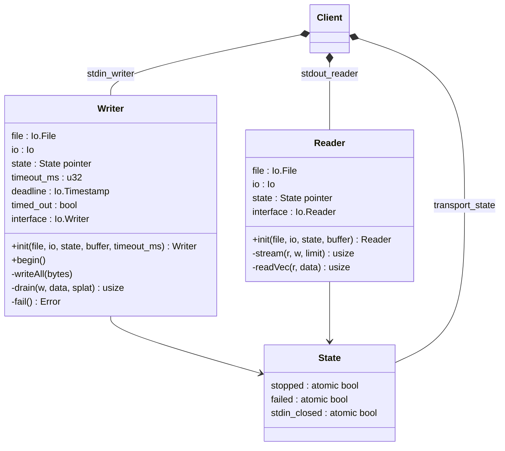
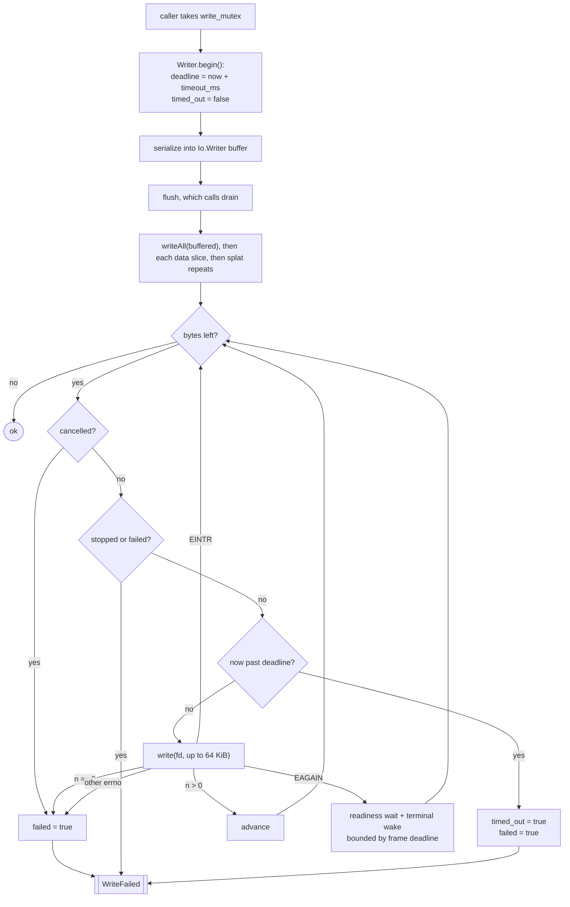
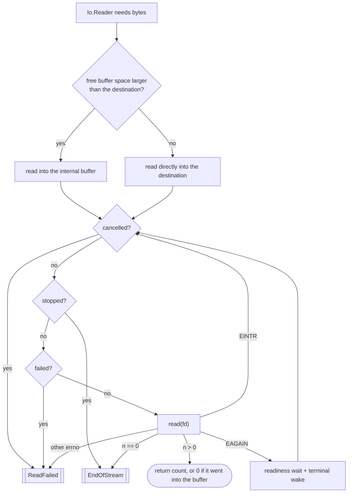
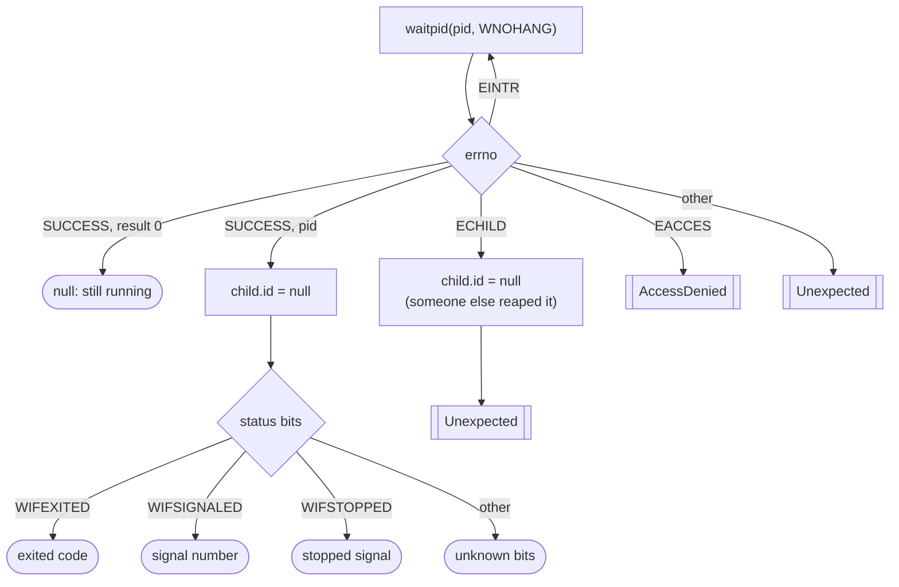

# Transport

`src/transport.zig` puts the `std.Io.Reader` and `std.Io.Writer` interfaces
on top of raw nonblocking POSIX pipes. It adds a write deadline and lets other
threads stop a blocked read or write by setting a flag. It also has
`pollChild`, a nonblocking `waitpid` wrapper.

## Why not `Io.File.Reader` / `Io.File.Writer`

The standard file reader and writer block inside the kernel. A blocked call
can only be released by closing the descriptor. That would be unsafe here,
because the number could be reused while another thread still holds it. The
custom transport instead:

1. Sets `O_NONBLOCK` on both pipes (`nonblocking`, via `fcntl`).
2. On `EAGAIN`, probes readiness for up to 2 ms once. If still idle, starts a
   `std.Io.Threaded` readiness task that polls the pipe plus a wake descriptor, while
   the caller parks in a cancelable `Io.Event` wait. Writes retain their deadline.
3. Checks the `stopped` / `failed` flags and `io.checkCancel()` on every
   iteration.

Stopping or failing the transport publishes the flag and signals its wake
descriptor, waking every blocked readiness task. Canceling a read or write also
wakes and joins its task and makes the transport terminal. No descriptor closes
under an active task. A runtime that cannot start a concurrent task falls back
to bounded polling. Other I/O runtimes also use that fallback, so raw polling
cannot block a fiber scheduler. The Threaded idle path has no periodic timer.

## Structure

Both structs are embedded in `Client`. Their `interface` vtable functions
recover the parent with `@fieldParentPtr("interface", ...)`, which is why
`Client` is heap-allocated and must not move.

## Write path

The deadline covers one whole frame, starting from `begin()`, which runs
after the write lock is acquired. Time spent waiting for the lock, and time
inside synchronous handlers, is not limited.

Once `failed` is set, every later write fails at once, even after another
`begin()`. A frame that was partly written leaves the stream at an unknown
position, so carrying on would send corrupt data. `Client.writeFailure`
reports `WriteTimedOut` when `timed_out` is set and `WriteFailed`
otherwise, and moves a pending initialization to `failed`.

## Read path

`stopped` reads as a clean end of stream, so a terminated session's
`next()` returns `null`. `failed` reads as an error, so a broken session is
reported, not hidden.

## Reaping: `pollChild`

On macOS with `std.Io.Threaded`, `watchChild` registers a process-exit notification in a close-on-exec
kqueue. Waiters observe its readiness without draining the exit event, so all
waiters wake. They still call `pollChild` under `state_mutex`; the notification
never reaps the process or publishes its status. A canceled waiter wakes only
its own readiness task and leaves the session and other waiters intact. The
termination grace interval is the readiness deadline before SIGKILL escalation.
Platforms without this exit descriptor retain the polling fallback.

The caller must hold `state_mutex`, the same lock that guards signaling, so
that a PID that was just reaped can never be signaled again.

## Tests

The transport's own tests in `src/transport.zig` use real pipes:

- Buffered bytes and repeated splat slices arrive in order (`"abcdxyxyxy"`).
- A full pipe reaches the write deadline, sets `timed_out` and `failed`, and
  stays failed after a new `begin()`.
- A one-byte reader buffer still reads whole lines. Setting `failed` produces
  `ReadFailed` and setting `stopped` produces `EndOfStream`, without the
  descriptor being touched.

`tests/transport_contract_test.zig` checks the public behavior: transport
failure, cancellation, and framing across fragmented reads.
