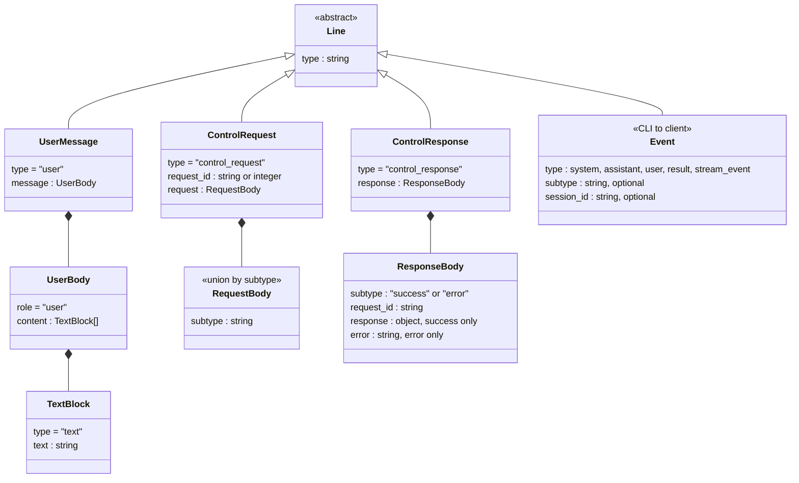
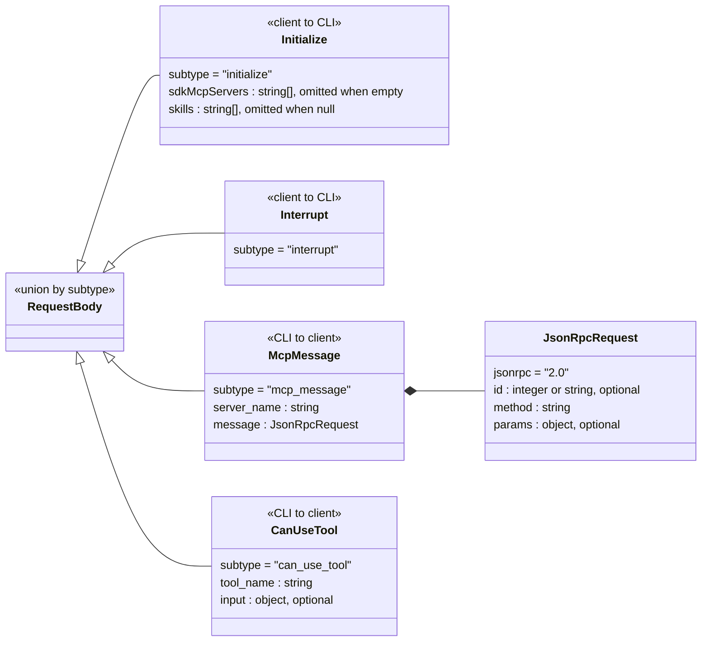
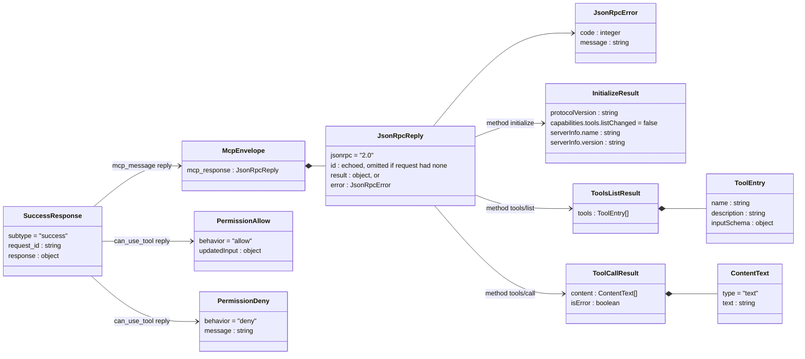
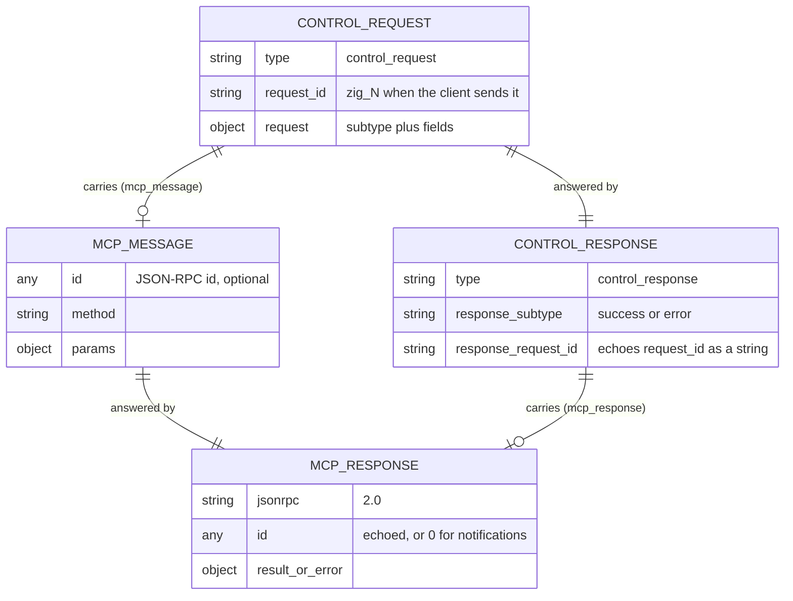

# Wire protocol

Every message is one compact JSON object followed by `\n`. The client writes
to the child's stdin and reads from its stdout. The CLI's outbound event
schema is open-ended and keeps gaining fields, so the client parses it to
`std.json.Value`. The shapes the client writes are fixed in
`src/protocol.zig` and pinned by tests there.

Field names are exact. Inline values in the examples are illustrative.

## Message families



## Request subtypes



## Success response bodies



## Client to CLI messages

### User turn (`send`)

```json
{"type":"user","message":{"role":"user","content":[{"type":"text","text":"Summarize README.md"}]}}
```

`sendCommand("code-review", "src/")` sends the same shape with the text
`/code-review src/`. With empty arguments, the space is left out. Both name
and arguments are JSON-escaped directly into the string.

### `initialize`

```json
{"type":"control_request","request_id":"zig_1","request":{"subtype":"initialize","sdkMcpServers":["host"],"skills":["code-review"]}}
```

- `request_id` is on the envelope, never inside `request`.
- `sdkMcpServers` is left out when no servers are registered.
- `skills` is left out when `Options.skills == null` (all allowed) and sent
  as `[]` when it is empty (none allowed).

### `interrupt`

```json
{"type":"control_request","request_id":"zig_2","request":{"subtype":"interrupt"}}
```

### MCP result

```json
{"type":"control_response","response":{"subtype":"success","request_id":"req_7","response":{"mcp_response":{"jsonrpc":"2.0","id":7,"result":{"content":[{"type":"text","text":"42"}],"isError":false}}}}}
```

`result` is spliced in from a body the client rendered itself. `id` repeats
the JSON-RPC id exactly as it arrived, and is left out if the request had
none.

### MCP error

```json
{"type":"control_response","response":{"subtype":"success","request_id":"req_8","response":{"mcp_response":{"jsonrpc":"2.0","id":3,"error":{"code":-32601,"message":"unknown tool"}}}}}
```

A JSON-RPC error still travels in a `success` control response. The control
layer worked; the error is at the MCP layer.

| Code | Messages used |
|---|---|
| `-32601` | `unknown server`, `unknown tool`, `unsupported mcp method` |
| `-32602` | `missing params`, `missing tool name` |
| `-32603` | `out of memory`, `result too large: register fewer tools or shorten their metadata` |

### Notification acknowledgement

For any method starting with `notifications/`:

```json
{"type":"control_response","response":{"subtype":"success","request_id":"req_9","response":{"mcp_response":{"jsonrpc":"2.0","id":0,"result":{}}}}}
```

The CLI expects an empty result with id `0` here.

### Control error

Used for unsupported subtypes and malformed requests that still have an id:

```json
{"type":"control_response","response":{"subtype":"error","request_id":"req_10","error":"unsupported control request"}}
```

Messages used: `missing request body`, `missing request subtype`,
`unsupported control request`, `missing mcp message`, `missing mcp method`,
`missing tool_name`.

### Permission allow

```json
{"type":"control_response","response":{"subtype":"success","request_id":"req_11","response":{"behavior":"allow","updatedInput":{"command":"ls -la"}}}}
```

With `.allow` the original `input` is echoed back. With `.allow_with_input`
the handler's JSON object is checked, compacted (whitespace outside strings
removed, so it stays on one line) and spliced in.

### Permission deny

```json
{"type":"control_response","response":{"subtype":"success","request_id":"req_12","response":{"behavior":"deny","message":"The shell is off in this session; use Read and Grep instead."}}}
```

## CLI to client messages

### `mcp_message` request

```json
{"type":"control_request","request_id":"req_7","request":{"subtype":"mcp_message","server_name":"host","message":{"jsonrpc":"2.0","id":7,"method":"tools/call","params":{"name":"add","arguments":{"a":"17","b":"25"}}}}}
```

Methods the client handles: `initialize`, `notifications/*`, `tools/list`,
`tools/call`. For `initialize`, `params.protocolVersion` is echoed back. If
it is missing, `2025-06-18` is used.

### `can_use_tool` request

```json
{"type":"control_request","request_id":"req_11","request":{"subtype":"can_use_tool","tool_name":"Bash","input":{"command":"ls -la"}}}
```

### Control response to a client request

```json
{"type":"control_response","response":{"subtype":"success","request_id":"zig_1"}}
{"type":"control_response","response":{"subtype":"error","request_id":"zig_2","error":"<CLI diagnostic text>"}}
```

### Events returned to the caller

These are open schemas. The fields below are the ones the client's accessors
read.

| `type` | Fields read by accessors | Notes |
|---|---|---|
| `system` | `subtype`, `session_id`, `skills[]`, `tools[]`, `slash_commands[]` | `subtype` is `init`, `api_retry` or `plugin_install`. |
| `assistant` | `session_id` | Full assistant message. Read it through `root()`. |
| `user` | `session_id` | Tool results echoed back as user content. |
| `stream_event` | `event.delta.type`, `event.delta.text` | Only with `include_partial_messages`. `textDelta()` reads `text_delta`. |
| `result` | `result`, `subtype`, `session_id`, `terminal_reason` | Last message of a turn, with cost and session metadata. |

Example `stream_event` text delta:

```json
{"type":"stream_event","session_id":"s-1","event":{"type":"content_block_delta","delta":{"type":"text_delta","text":"Hel"}}}
```

## Correlation rules



- The control-layer `request_id` and the JSON-RPC `id` are separate. The
  client echoes each one where it belongs.
- Inbound `request_id` may be a string or an integer, at the top level or
  under `request`. Replies always send it as a string.
- Only `zig_N` ids issued by this client are matched against the pending
  table. Anything else is ignored.

## Framing invariants

- One frame per line. Every serializer writes compact JSON, and the two
  spliced raw values (`inputSchema` and `updatedInput`) are compacted first
  so that a pretty-printed schema cannot add a newline.
- Raw values are checked before splicing: they must parse as JSON, start
  with `{`, and nest at most 128 deep.
- Control replies are at most 16 896 bytes, newline included.
- A frame is written whole under `write_mutex`, so a `send` from another
  thread can never land inside a reply.
